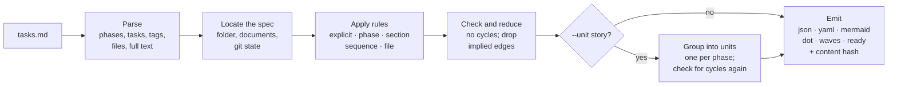
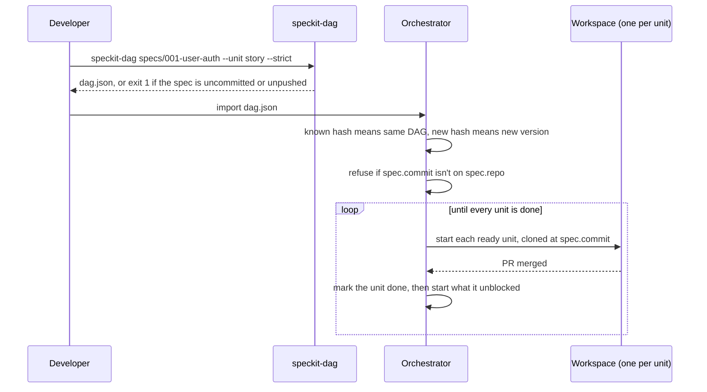

# speckit-dag

`speckit-dag` turns a [Spec Kit](https://github.com/github/spec-kit) `tasks.md` into an
explicit dependency graph (a DAG). An orchestrator can use that graph to run the work in
parallel, across many agents or workspaces, in a safe order.

```bash
speckit-dag specs/001-user-auth --unit story --strict -o dag.json
```

## Why this exists

Spec Kit's `/speckit.tasks` writes a checklist that a person or a single agent works down
from top to bottom. The order between tasks is mostly implied by the layout: phases, `###`
sections, `[P]` markers and file paths. Running that checklist in parallel takes more than
the file gives you:

| An orchestrator needs | What `tasks.md` gives it | What `speckit-dag` adds |
|---|---|---|
| Which tasks must wait for which | Layout conventions and the odd "depends on T012" | Explicit edges, each tagged with the rule that created it |
| What can run at the same time | `[P]` on some lines | `waves`: batches of work that can run together |
| Work that can be merged on its own | Tasks too small to merge alone: a story's tests fail until its code lands | `--unit story`: one node per phase or story, so one node is one PR |
| What to tell each agent | One line of text per task | The task's full text, its section's Goal, and paths to spec.md, plan.md and the other documents |
| Which graph it is running, built from which code | Nothing | A content hash, plus the repo, branch, commit, and whether the spec is committed and pushed |

The output is a generic JSON format ([schema](schema/speckit-dag.schema.json)) with nothing
Spec Kit-specific in it, so other planners can produce the same file.

## How it works



1. **Parse.** The parser reads each phase (`## Phase N: …`), section (`### …`) and task line
   (`- [ ] T012 [P] [US1] Description in path/to/file.py`). For each task it records the
   tags, the file paths it mentions, any dependencies written in the text, and the task as
   written, including indented notes under it.
2. **Locate the spec.** It finds the feature folder around `tasks.md`, the Spec Kit
   documents beside it, and the git state: repo, branch, commit, whether the folder has
   uncommitted changes, and whether the commit is on `origin`.
3. **Apply rules.** Each rule turns one Spec Kit convention into edges (see
   [the rules](#how-dependencies-are-worked-out)). Each edge records which rules created it.
4. **Check and reduce.** A cycle is an error that names the loop. Edges that a longer path
   already implies are dropped: `A→B→C` makes `A→C` redundant.
5. **Group** (optional). `--unit story` merges each phase into one node and checks again,
   because grouping can create a cycle the task graph didn't have.
6. **Emit.** The graph is written in the format you choose, with a content hash that
   identifies it.

## Quick start

The tool needs Python 3.9 or later and has no runtime dependencies. YAML output needs PyYAML.

```bash
pip install 'speckit-dag[yaml] @ git+https://github.com/ps06756/speckit-dag'
# or, from a clone:  pip install -e '.[yaml]'

speckit-dag specs/001-user-auth                     # JSON graph, one node per task
speckit-dag specs/001-user-auth --unit story        # one node per phase or user story
speckit-dag specs/001-user-auth -f waves            # what can run in parallel
speckit-dag specs/001-user-auth -f ready            # what can start right now
speckit-dag specs/001-user-auth -f mermaid -o dag.mmd
```

The input can be a `tasks.md`, the spec folder that holds it, or `-` for stdin. Here is
the start of `-f waves` for the sample in [`examples/`](examples/specs/001-user-auth):

```
Wave 1:
  [x] T001  Create project structure per implementation plan
Wave 2:
  [ ] T002  Configure ruff and black in pyproject.toml
  [ ] T003  Add CI workflow in .github/workflows/ci.yml
Wave 3:
  [ ] T004  Set up database schema and migrations in src/db/migrations/
...
```

## Using it with an orchestrator



- **Generate with `--strict`.** The command fails when the spec folder has uncommitted
  changes or the commit isn't on `origin`. A workspace cloned from the remote can't see
  those changes.
- **Identify the graph by `hash`.** The orchestrator assigns its own DAG id and stores the
  hash beside it. Importing a known hash is a re-import, not a duplicate. A new hash for the
  same spec is a new version, so a running DAG is never changed underneath it.
- **Check the commit again at import.** `spec.pushed` only reflects the last `git fetch`.
- **Brief each workspace from the node.** A unit node has the section's full text (Goal,
  Independent Test), its tasks in the order to do them with each task's full text and `ref`,
  and `spec.docs` lists spec.md, plan.md and the other documents to read.
- **Schedule from the edges.** A node is ready when it isn't done and everything it depends
  on is done. `-f ready` prints that list, and `waves` gives the whole plan up front.

## How dependencies are worked out

Each rule adds edges for one Spec Kit convention and records itself in the edge's `reasons`,
so any edge can be traced back to its cause.

| Reason | Rule |
|---|---|
| `explicit` | The task text names them: `depends on T012`, `after T010, T011`, `blocked by T008-T010`. Indented lines under a task count too. |
| `phase` | Setup → Foundational → user stories → Polish. Neighbouring user-story phases run **in parallel** (`--sequential-stories` chains them). |
| `section` | `###` sections inside a phase run in order, so tests come before implementation. |
| `sequence` | A task without `[P]` waits for the tasks before it in its section. A run of `[P]` tasks all wait on the same earlier task, not on each other. |
| `file` | Tasks that touch the same file run in file order, even if both are `[P]` (`--no-file-conflicts` turns this off). Directories (`src/models/`) don't count. Linking two user stories this way gives a warning. |

## Tasks or units of work

By default a node is one task. That is too small to merge on its own. In the sample, T008
and T009 are the sign-up tests, and T010–T013 make them pass. Merged alone, T008 puts
failing tests on `main` and breaks CI for everyone.

`--unit story` makes each phase one node: Setup, Foundational, each user story and Polish.

```
$ speckit-dag examples/specs/001-user-auth --unit story -f waves
Wave 1:
  [~] setup  Setup (Shared Infrastructure)  (3 tasks, 1 done)
Wave 2:
  [ ] foundational  Foundational (Blocking Prerequisites)  (4 tasks)
Wave 3:
  [ ] US1  User Story 1 - Sign up with email  (6 tasks)
  [ ] US2  User Story 2 - Log in  (3 tasks)
Wave 4:
  [ ] US3  User Story 3 - Reset password  (2 tasks)
Wave 5:
  [ ] polish  Polish & Cross-Cutting Concerns  (3 tasks)
```

- **Unit edges:** a unit depends on another when any of its tasks depends on a task in the
  other. Each unit edge lists the task edges behind it in `via`. Here US3 waits for US1
  because T017 depends on T011.
- **Status:** a unit is `done` when all its tasks are, `in_progress` when some are, and
  `todo` otherwise.
- **Cycles:** two stories whose tasks depend on each other in both directions form a cycle
  once grouped, even though the task graph is fine. The error names the tasks:

  ```
  speckit-dag: grouping by story creates a cycle: US1 -> US2 -> US1. US2 needs US1 because
  of T001 -> T003; US1 needs US2 because of T004 -> T002. Move the shared tasks into
  Foundational or into one story, or use --unit task.
  ```
- **Misplaced tasks:** a task tagged with one story but placed in another phase ships with
  its phase, and you get a warning.

The trade-off is less parallel work. At the task level only T017 waits for T011. As units,
all of US3 waits for the whole US1 PR. `via` shows which task to move into Foundational to
get that parallelism back.

## The output format

An edge means `to` depends on `from`. This sample is trimmed to one group, one node and one
edge:

```json
{
  "version": 1,
  "unit": "task",
  "hash": "sha256:7a26eee8f727a162ad0fe561131d0809a1a9ced97a5e08956e5765bb38f8e24a",
  "feature": "User Authentication",
  "source": "specs/001-user-auth/tasks.md",
  "spec": {
    "id": "001-user-auth",
    "dir": "specs/001-user-auth",
    "tasks": "specs/001-user-auth/tasks.md",
    "docs": { "spec": "specs/001-user-auth/spec.md", "plan": "specs/001-user-auth/plan.md",
              "data-model": "specs/001-user-auth/data-model.md" },
    "repo": "git@github.com:acme/app.git",
    "branch": "001-user-auth",
    "commit": "c2bb496a07c292b289bf27cd3bb21cfc3c09373b",
    "dirty": false,
    "pushed": true
  },
  "groups": [{ "id": "US1", "name": "Phase 3: User Story 1 - Sign up with email (Priority: P1) 🎯 MVP",
               "kind": "story", "order": 2, "story": "US1", "priority": "P1", "mvp": true,
               "line": 36, "end_line": 53,
               "text": "## Phase 3: User Story 1 - Sign up with email ...\n\n**Goal**: A visitor can ..." }],
  "nodes":  [{ "id": "T012", "title": "Implement SignupService in src/services/signup.py",
               "group": "US1", "section": "implementation", "parallel": false, "story": "US1",
               "files": ["src/services/signup.py"], "status": "todo",
               "ref": "specs/001-user-auth/tasks.md#T012", "line": 49, "end_line": 52, "tags": [],
               "text": "- [ ] T012 [US1] Implement SignupService in src/services/signup.py\n  - Hash the password with the helpers in src/lib/crypto.py\n  - ..." }],
  "edges":  [{ "from": "T011", "to": "T012", "reasons": ["sequence"] }],
  "waves":  [["T001"], ["T002", "T003"]],
  "warnings": []
}
```

| Field | Meaning |
|---|---|
| `unit` | What a node is: `task`, or `story` for units of work. Unit nodes add `kind` and a `tasks` list, and unit edges add `via`. |
| `hash` | Identifies the content. See [graph identity](#graph-identity). |
| `spec` | Where the feature lives and the git state it was built from. Paths, `source` included, are relative to the repository root. |
| `groups` | Phases and user stories in file order, each with its whole section as `text`. |
| `nodes[].ref` | `<path to tasks.md>#<task id>`. It stays valid when lines move. To resolve it, search the file for the task ID; `line` is only a hint. |
| `nodes[].text` | The task as written, with any indented notes or code under it. |
| `waves` | Node ids in batches. Everything in a batch can run once the earlier batches are done. |
| `warnings` | Problems found, such as an unknown dependency or an uncommitted spec. |

Outside a git repository, or with `--no-git`, paths are relative to the working directory
and the git fields are null. Input from stdin has no `spec`, so `ref` is null too.

### Graph identity

- **`hash`** is the same on any commit, branch or machine as long as the tasks are the same.
  - It covers the groups, nodes, edges, `unit` and the format version.
  - It leaves out where the graph came from (`source`, `spec`, `ref`), line numbers, and
    progress (`status`, and the `[x]` marks in `text`).
  - Ticking tasks done or adding a blank line keeps the hash. Changing a task, its notes, a
    story's Goal, a dependency, or an option such as `--sequential-stories` gives a new one.
- **`dirty`** is true when anything in the spec folder (modified, staged or untracked)
  differs from the commit. Changes outside the spec folder don't count.
- **`pushed`** is true when the commit is on an `origin` branch, as of the last fetch.

Each of these situations gives a warning, and `--strict` fails on warnings: uncommitted
changes in the spec folder, a commit not on `origin`, no `origin` remote, no commits, or not
being in a git repository.

```
warning: specs/001-user-auth has changes that aren't committed (specs/001-user-auth/tasks.md);
workspaces cloned from the remote won't see them
warning: commit 2fedf30 isn't on origin yet (as of the last fetch); push it so workspaces can clone it
```

## Formats and options

| Format (`-f`) | Output |
|---|---|
| `json` (default) | The generic graph above |
| `yaml` | The same data as YAML |
| `mermaid` | A flowchart with a subgraph per phase. GitHub draws it in Markdown. |
| `dot` | Graphviz, for `dot -Tsvg` |
| `waves` | Plain text, one block per wave |
| `ready` | One line per node that can start now: id, a tab, then the title |

| Option | Effect |
|---|---|
| `-o FILE` | Write to a file instead of stdout |
| `--unit task\|story` | One node per task (default), or one per phase or user story |
| `--sequential-stories` | Run user stories one after another instead of in parallel |
| `--no-file-conflicts` | Don't order tasks that touch the same file |
| `--no-reduce` | Keep edges that longer paths already imply |
| `--no-git` | Skip the git state and its checks; paths become relative to the working directory |
| `--strict` | Exit with status 1 if there are any warnings |
| `-q` | Don't print warnings |

The exit status is 0 on success, 1 on an error (a cycle, a missing file, no tasks found, or
a warning under `--strict`), and 2 for invalid arguments.

## Using it from Python

```python
from speckit_dag import load, Options, group_by_story, waves, ready, to_dict

g = load("specs/001-user-auth", Options(sequential_stories=False))
waves(g)      # [["T001"], ["T002", "T003"], ...]
ready(g)      # tasks not done whose dependencies are all done
to_dict(g)    # the generic format as a dict, hash included

units = group_by_story(g)   # raises CycleError if stories depend on each other
ready(units)                # ["setup"]
units.by_id["US1"].tasks    # the tasks to do in that workspace, in order
```

## Limits

- File paths are found by pattern, such as `src/models/user.py` or `pyproject.toml`. A path
  written another way can be missed, and then two tasks touching it won't be ordered. Paths
  that appear only in a task's indented notes don't count either.
- Task ids are unique only within one `tasks.md`. Use `ref`, or the hash plus the id, to tell
  tasks apart across specs.
- `pushed` is as fresh as the last `git fetch`.
- The parser follows Spec Kit's tasks template. Other `##` headings that hold tasks are
  treated as phases of kind `other`, which run in file order.

## Repository layout

```
speckit_dag/
  parser.py    tasks.md -> phases and tasks (tags, files, deps, text)
  spec.py      find the spec folder, its documents and the git state
  rules.py     one function per dependency rule, plus build_graph()
  graph.py     cycle check, redundant-edge removal, waves, ready
  units.py     group tasks into units of work (--unit story)
  identity.py  the content hash
  emit.py      json / yaml / mermaid / dot / waves / ready
  cli.py       the speckit-dag command
schema/        JSON Schema for the output format
examples/      a sample Spec Kit feature folder (specs/001-user-auth) and its outputs (output/)
tests/
```

The JSON files in `examples/output/` are built with `--no-git`, so they don't change with
every commit.

## Development

```bash
pip install -e '.[dev]'
pytest
```
